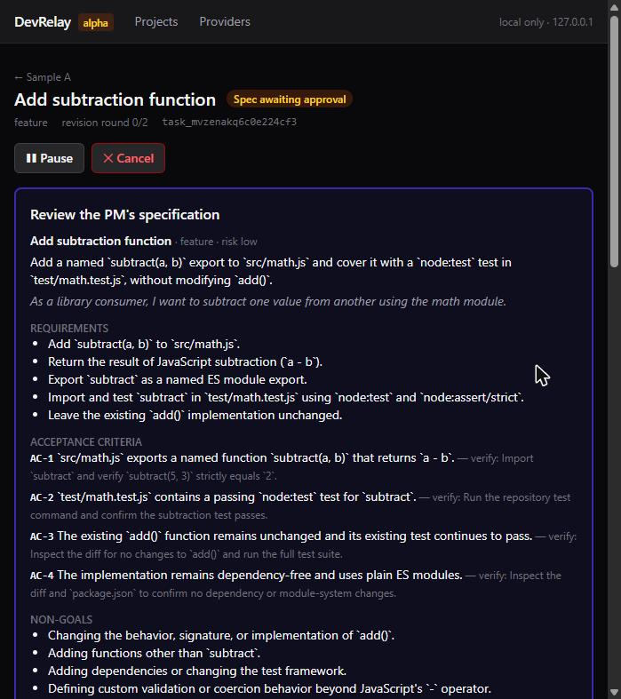
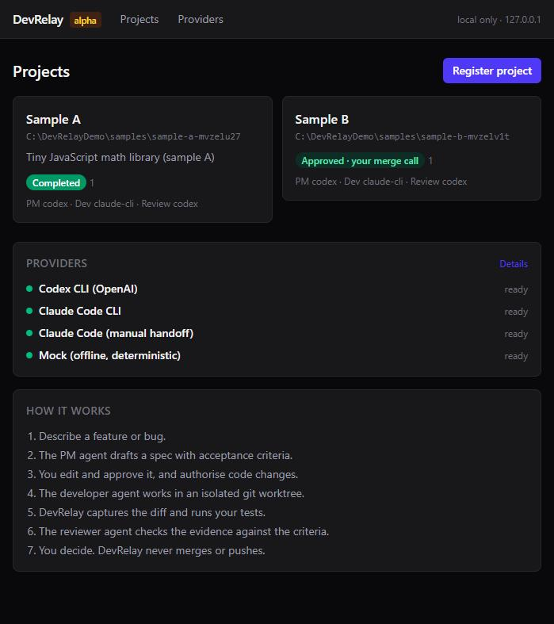
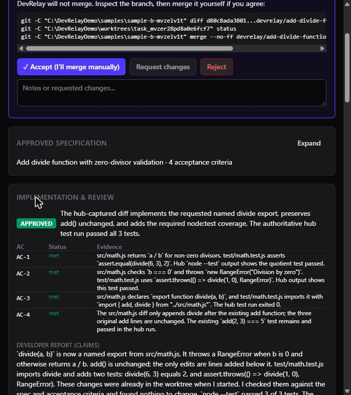
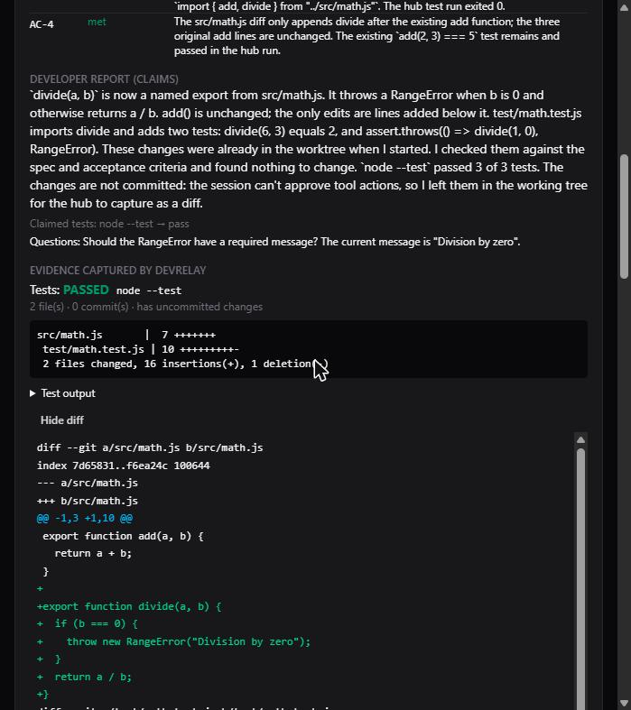
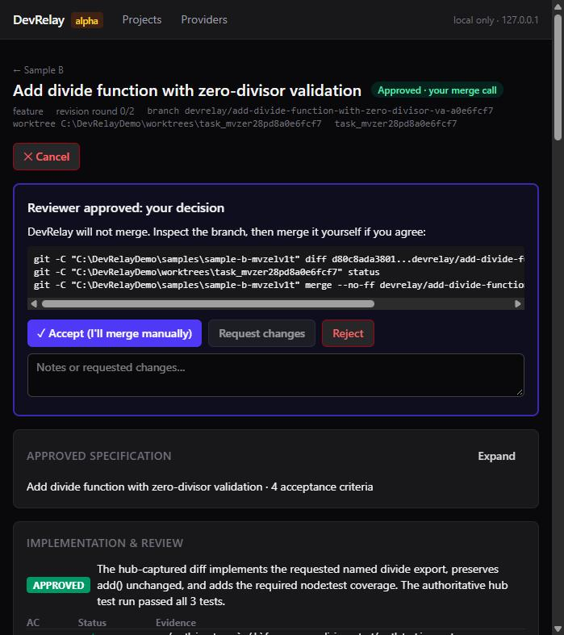

# DevRelay

**A local-first, multi-agent software development orchestrator.** DevRelay passes work between three AI roles: a *product manager*, a *developer* and a *code reviewer*. Each role runs on an AI coding CLI you already have installed and signed in to. DevRelay keeps the project context, stops for your approval at every important step, and never merges, pushes or deploys.

> **Status: alpha (`v0.1.0-alpha.1`).** Tested on Windows 11. See [Supported platforms](#supported-platforms) and [Known limitations](#known-limitations).
> DevRelay is an independent open-source project. It is **not** an official OpenAI or Anthropic product, and it is not affiliated with or endorsed by either company.



## Why

If you use one AI tool as your PM and another as your developer, you end up copying requirements, questions, diffs and reviews between them by hand. DevRelay does that relay for you, locally:

- **Structured hand-offs.** Specs, implementation reports and reviews are schema-validated JSON. Malformed agent output is rejected, not guessed at.
- **Evidence over claims.** The reviewer judges the git diff and test run that *DevRelay* captured, not just the developer's word.
- **Bounded automation.** There is a revision-round limit (default 2). DevRelay stops immediately on auth errors, usage limits or invalid output. Nothing loops forever.
- **Human gates.** You approve the spec, authorise code changes for each task, and make the final merge call.
- **Project memory.** Goals, constraints and instructions are kept per project, along with decisions captured from accepted tasks. Agents get compact context, not whole chat histories.
- **Bring your own provider.** DevRelay runs the official CLIs *you* installed, with *your* login. It never sees, stores or forwards credentials.

## 5-minute quickstart (Windows PowerShell)

You need **Node.js 22 or 24** and **Git**. The first step needs nothing else: no AI accounts, no API keys.

```powershell
git clone https://github.com/UsmanJ/dev-relay.git
cd dev-relay
npm install

npm run demo     # 1. offline PM -> developer -> reviewer cycle (mock agents)

npm run build
npm start        # 2. open http://127.0.0.1:3210
```

Then connect the real tools you already use (each person signs in with their own account):

```powershell
npm install -g @openai/codex
codex login              # choose "Sign in with ChatGPT"

# Claude Code: install per https://code.claude.com/docs,
# run `claude` once and sign in, then check:
claude auth status       # expect "authMethod": "claude.ai"

npm run doctor           # shows what DevRelay can use
```

Optionally, opt in to **automated** Claude Code runs (the default is a manual handoff). Read [docs/PROVIDERS.md](docs/PROVIDERS.md) first:

```powershell
npm run relay -- claude-automation enable    # shows what you confirm
npm run relay -- claude-automation enable --i-acknowledge
npm run demo -- --real   # 3. real Codex -> Claude -> Codex cycle (~1 min)
```

The real demo creates a tiny sample library under `data/samples/`. Codex writes the spec, Claude Code implements it on a new branch in an isolated worktree, DevRelay runs the tests itself, and Codex reviews the result. It stops before any merge, and it counts against **your own** plan's usage limits.

macOS and Linux use the same commands in your usual shell.

## Screenshots

| | |
|---|---|
|  |  |
| **Projects & provider status:** each project is a registered local repo | **Review:** verdict per acceptance criterion, based on DevRelay's evidence |
|  |  |
| **Evidence:** DevRelay's own test run and diff, next to the developer's claims | **Your decision:** DevRelay prints the git commands; you merge |

## How it works

```
 you ── request ──► PM adapter (read-only) ──► TaskSpecification (validated)
                                                       │
                 you approve the spec + authorise ◄────┘
                                │
                                ▼
          new branch in an isolated git worktree ──► developer adapter
                                                       │
     DevRelay captures the diff and runs your tests ◄──┘
                                │
                                ▼
              reviewer adapter (read-only) judges the evidence
                ├─ APPROVED ───────────► you decide (DevRelay never merges)
                ├─ CHANGES_REQUESTED ──► developer again (max N rounds)
                └─ HUMAN_DECISION ─────► you

 All state in local SQLite · one Node.js process · bound to 127.0.0.1
```

- **Engine** (`src/core`): a task state machine with audited transitions, the orchestrator, a job manager (cancellation, concurrency cap, crash recovery), prompt and context assembly, git helpers, and a subprocess runner that never uses a shell.
- **Adapters** (`src/core/providers`): a capability-based registry. The engine doesn't know vendor names, so new CLI or API adapters can be added without touching the workflow.
- **Interfaces:** a Next.js dashboard and JSON API bound to `127.0.0.1`, plus a CLI (`npm run relay -- help`). Both share the same engine.

Details: [docs/ARCHITECTURE.md](docs/ARCHITECTURE.md).

## Providers

| Adapter | Roles | Runs | Billing |
|---|---|---|---|
| `codex` | PM, reviewer | `codex exec --sandbox read-only --output-schema …` | your ChatGPT plan's Codex limits |
| `claude-cli` (opt-in) | PM, developer, reviewer | `claude -p --restricted --permission-prompts none …` | your Claude plan's limits |
| `claude-manual` | developer | you run Claude Code; DevRelay writes `TASK.md` and ingests `RESULT.json` | your Claude plan |
| `mock` | all | built-in, offline, deterministic | none |

**Defaults:** Codex as PM and reviewer, and a **manual Claude Code handoff** as developer: DevRelay writes the task file, you run Claude Code yourself, and DevRelay ingests the result. **Automated** Claude Code execution (`claude-cli`) is off until you accept a one-time acknowledgement, on the Providers page or with `npm run relay -- claude-automation enable`. There you confirm that you use your own officially authenticated Claude installation and comply with the applicable terms. The acknowledgement does not override any provider restriction. If you only have Claude, you can use `claude-cli` for all three roles once you have opted in.

**No paid API access is enabled by default.** API-key variables (`OPENAI_API_KEY`, `ANTHROPIC_API_KEY`, …) are stripped from every child process. A CLI that reports API-key authentication is refused, and API-metered adapters stay disabled unless you explicitly opt in.

> ⚠️ **Read [docs/PROVIDERS.md](docs/PROVIDERS.md) before automating.** Vendor terms distinguish personal use of their own tools from third-party integrations. DevRelay is designed for **one person running it locally with their own logins**. Hosting it for others, or sharing a subscription through it, is not supported and likely breaches those terms. Some points are not explicitly addressed by the vendors (see "Unresolved questions"). If in doubt, use the `claude-manual` handoff mode.

## Using it with your own projects

1. **Register project**: enter the absolute path to a local repo **root**. DevRelay verifies it with git first, and never clones or touches unregistered repos.
2. Add goals, constraints and instructions. You can import Markdown or text notes, for example a summary you exported from a ChatGPT conversation (DevRelay cannot read your ChatGPT history).
3. Optionally set a test command (e.g. `npm test`) and allow DevRelay to run it.
4. Describe a feature or bug. The PM drafts a spec, which you approve after authorising execution. Then watch the timeline.
5. When the reviewer approves, inspect the branch `devrelay/<slug>-<id>` and merge it yourself.

CLI equivalents and settings: [docs/REGISTERING-PROJECTS.md](docs/REGISTERING-PROJECTS.md).

## What is automatic and what needs you

| Step | Automatic? |
|---|---|
| PM drafts or redrafts the spec | ✅ when you submit a request or send feedback |
| Spec approval and per-task execution authorisation | 🧑 always you |
| Worktree and branch creation | ✅ after authorisation (asks first if the main repo is dirty) |
| Developer implementation | 🧑 `claude-manual` (default) · ✅ `claude-cli` after opt-in |
| Diff capture and test run | ✅ (tests only if you allowed them) |
| Review and revision loop | ✅ up to *max revisions*, then you |
| Merge, push, deploy, branch/worktree deletion | ❌ never; you do these yourself |

## Supported platforms

| Platform | Status |
|---|---|
| Windows 11 + PowerShell 5.1/7, Node 24 | ✅ tested (unit/integration tests, dashboard, real providers) |
| Windows + Node 22 | CI configured, not yet run |
| Linux, macOS | supported by design (POSIX process groups, path handling); CI configured, **not yet run** |
| WSL | expected to work as Linux; untested |

## Known limitations

- Real-provider runs have been verified on one machine only (codex-cli 0.166.0 with a ChatGPT login, Claude Code 2.1.316 with a Pro login), using small sample repositories.
- Usage-limit and auth failures are detected by matching CLI error text, which may change between CLI versions.
- The automated developer may only run allow-listed `git` subcommands and your test command. It sometimes can't commit, so DevRelay captures uncommitted changes as well.
- If the DevRelay process is killed, the running step is marked failed and can be retried. Partial edits stay in the worktree.
- There is no authentication on the local API beyond loopback, header and origin checks. Any process running as your OS user can call it.
- Worktrees and branches are never cleaned up automatically.

Full list: [CHANGELOG.md](CHANGELOG.md).

## Security

Read-only by default, explicit approvals before writes, isolated worktrees, argv-only subprocesses (no shell), a localhost server with DNS-rebinding and CSRF guards, secret redaction, timeouts, output caps, a concurrency cap, process-tree kill on cancel, and no telemetry (DevRelay sends none, and its npm scripts run Next.js with `NEXT_TELEMETRY_DISABLED=1`). Repository content is treated as untrusted. See [SECURITY.md](SECURITY.md), and report vulnerabilities privately.

## Development

```powershell
npm run verify   # typecheck + lint + offline tests + production build
npm run demo     # offline end-to-end run
```

Public CI (GitHub Actions) runs only these offline checks, with `DEVRELAY_OFFLINE=1`. It never installs or calls Codex or Claude, and it uses no secrets. Contributions are welcome. See [CONTRIBUTING.md](CONTRIBUTING.md).

## License

[Apache License 2.0](LICENSE). See [NOTICE](NOTICE) for trademark attributions.
